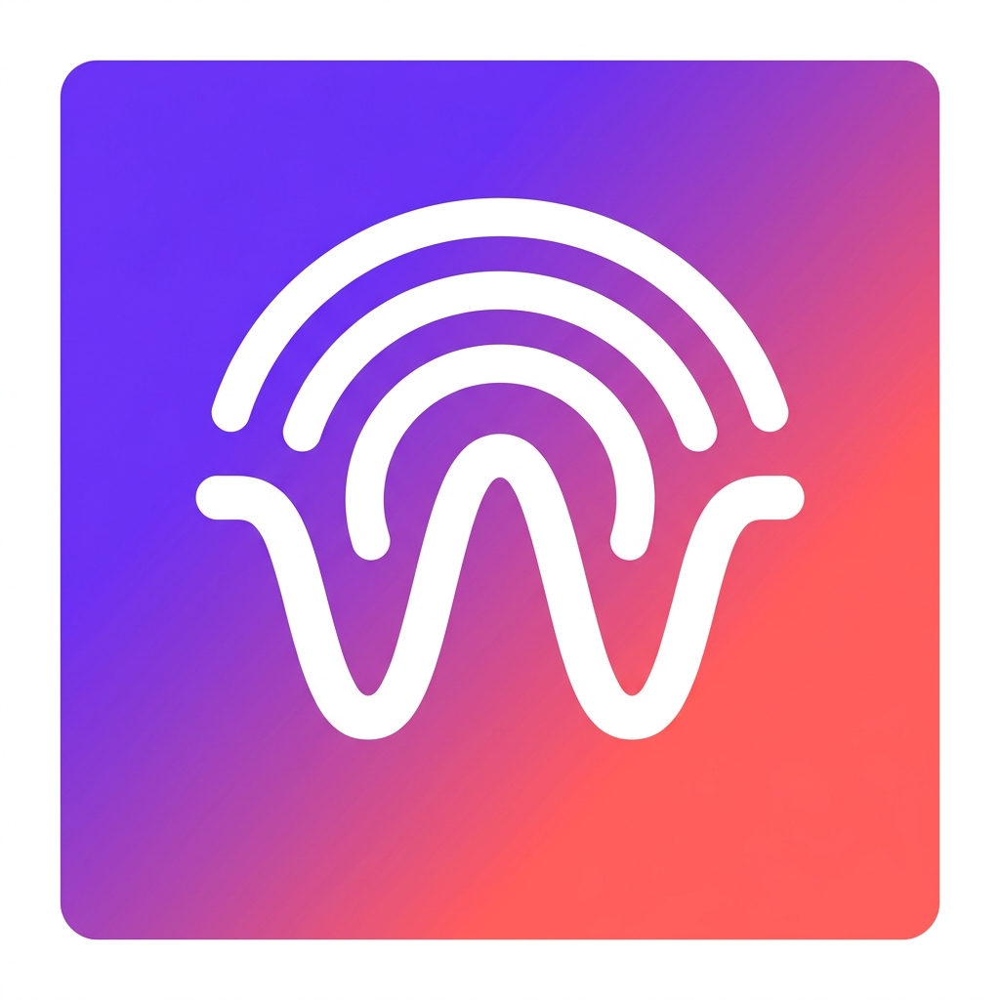

# 📻 Wavely — Modern Live Radio Streaming App

<div align="center">
  
  <h3>Experience radio stations from around the globe with a stunning, modern interface.</h3>

  [](https://www.typescriptlang.org/)
  [](https://reactnative.dev/)
  [](https://expo.dev/)
  [](https://github.com/pmndrs/zustand)
  [](https://opensource.org/licenses/MIT)
</div>

---

## ✨ Features

- 🌍 **30,000+ Stations Worldwide**: Powered by the decentralized Radio Browser API + curated global fallback stations (BBC World Service, Virgin Radio UK, Power FM, Jazz Radio Paris, Kiss FM, KEXP).
- 🎨 **Sleek Dynamic UI**: Automatic Dark/Light/System theme with glassmorphic floating mini-player and animated equalizers.
- ❤️ **Offline Favorites**: Persisted locally via AsyncStorage so your saved stations are always accessible.
- 🔍 **Real-time Search & Filter**: Filter by station name, genre tags, and country with instant debouncing.
- 📱 **Cross-Platform**: Designed and optimized for both iOS and Android.
- 🛠 **Enterprise Diagnostics**: Built-in in-app diagnostic logger with level filtering (Info, Warn, Error).
- 🧪 **Test Suite**: Comprehensive unit tests covering stores, API parsing, and helpers.

---

## 🏗 Architecture & Tech Stack

| Layer | Technology |
|---|---|
| **Framework** | Expo SDK 57 (Expo Router file-based routing) |
| **Language** | TypeScript (Strict mode) |
| **State Management** | [Zustand](https://github.com/pmndrs/zustand) + AsyncStorage persist |
| **Data Fetching** | [TanStack Query](https://tanstack.com/query) (React Query) |
| **Audio Engine** | `expo-audio` with background playback support |
| **Animations** | `react-native-reanimated` |
| **Testing** | Jest + `@testing-library/react-native` + `jest-expo` |
| **Linting & Code Style** | ESLint Flat Config + Prettier |

---

## 🚀 Getting Started

### Prerequisites
- Node.js `>= 22`
- npm or yarn

### 1. Installation
```bash
git clone https://github.com/<your-username>/wavely.git
cd wavely
npm install
```

### 2. Run Locally
```bash
npm start
```
Scan the QR code with **Expo Go** on iOS or Android, or press `a` for Android Emulator / `i` for iOS Simulator.

### 3. Running Tests & Quality Checks
```bash
# Typecheck
npm run typecheck

# Unit tests
npm test

# Linting
npm run lint

# Code formatting
npm run format
```

---

## 📦 Building an Android APK

### Option A: Cloud Build via EAS (Recommended)
No local Android Studio or heavy SDK required.
```bash
# 1. Install EAS CLI
npm install -g eas-cli

# 2. Login to Expo
eas login

# 3. Configure EAS Build
eas build:configure

# 4. Build a standalone APK (installable on any Android device)
eas build -p android --profile preview
```
Once completed, EAS will provide a direct download link for your `.apk` file!

### Option B: Local Android Build
```bash
npx expo run:android --variant release
```

---

## 📄 License
This project is licensed under the MIT License - see the [LICENSE](LICENSE) file for details.
